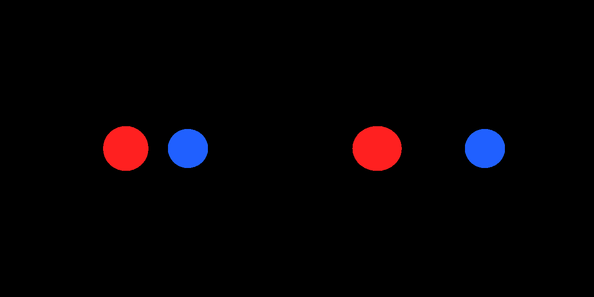
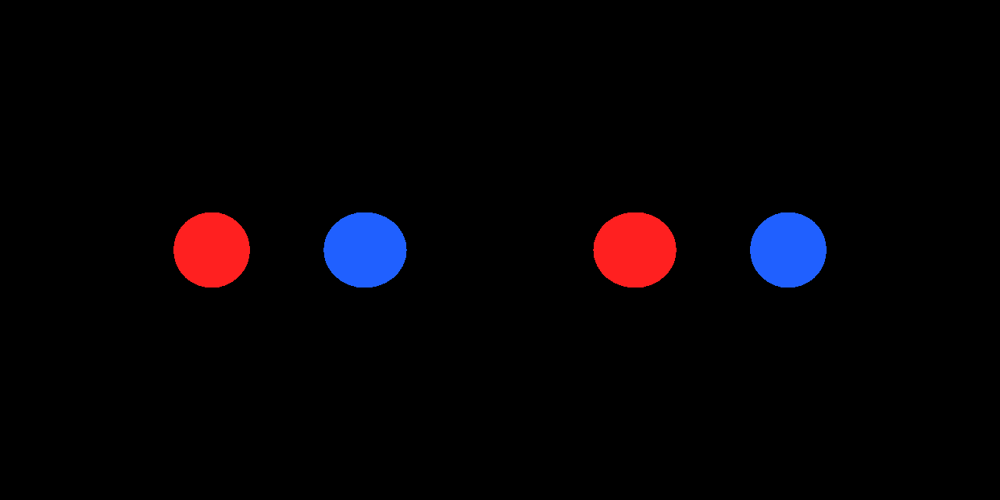

# WebGLRenderer + WebGLNodesHandler: NodeMaterials are rendered with zero stereo disparity in WebXR

Minimal reproduction for three.js (r184 NodeMaterial compatibility layer, [PR #32851](https://github.com/mrdoob/three.js/pull/32851)).

**Live examples** (open on a headset, press ENTER VR):

- https://tomingtoming.github.io/three-nodes-xr-repro/ — three@0.186.0 (jsdelivr)
- https://tomingtoming.github.io/three-nodes-xr-repro/dev.html — three dev build (raw.githack mrdoob/three.js/dev)
- append `?patch=1` to either for the workaround

Fallback if Pages is not up yet: https://raw.githack.com/tomingtoming/three-nodes-xr-repro/main/index.html

## Description

With `WebGLRenderer` + `renderer.setNodesHandler(new WebGLNodesHandler())`, a `MeshBasicNodeMaterial` sphere (blue) is drawn at the
**same screen position in both eyes** during an immersive-vr session, while a classic `MeshBasicMaterial` sphere (red) at the same
depth gets normal per-eye disparity. In the headset the blue sphere has no depth (it looks flat / at infinity). Outside XR both render identically.

## Reproduction steps

1. Open the live example on a WebXR headset (confirmed on Meta Quest) and enter VR.
2. Look at the two spheres 2 m ahead: red (classic) has depth, blue (NodeMaterial) does not.
3. Reload with `?patch=1`: blue now matches red.

## Root cause

1. `WebGLRenderer.render()` calls `_nodesHandler.renderStart( scene, camera )` **before** it swaps `camera` for `xr.getCamera()`
   ([src/renderers/WebGLRenderer.js#L1403](https://github.com/mrdoob/three.js/blob/dev/src/renderers/WebGLRenderer.js#L1403) vs
   [#L1677](https://github.com/mrdoob/three.js/blob/dev/src/renderers/WebGLRenderer.js#L1677)), so `nodeFrame.camera` stays the head camera.
2. `WebGLNodesHandler.onBeforeRenderCallback` receives the per-eye camera from the renderer but does not use it
   ([examples/jsm/tsl/WebGLNodesHandler.js#L339](https://github.com/mrdoob/three.js/blob/dev/examples/jsm/tsl/WebGLNodesHandler.js#L339)).

Camera-dependent node uniforms (`cameraViewMatrix`, `cameraProjectionMatrix`, `cameraPosition`, …) are therefore taken from the
head camera for both eyes.

## Workaround (app side)

```js
const handler = new WebGLNodesHandler();
renderer.setNodesHandler(handler);
const orig = handler.onBeforeRenderCallback;
handler.onBeforeRenderCallback = function (r, scene, camera, geometry, object) {
  if (camera && camera.isCamera && !camera.isArrayCamera) handler.nodeFrame.camera = camera; // per-eye camera
  return orig.call(this, r, scene, camera, geometry, object);
};
```

A proper fix is probably to set `nodeFrame.camera` in `onBeforeRenderCallback` (or call `renderStart` after the XR camera swap).

## Measurements (emulator, supporting evidence)

Headless Chromium + [IWER](https://github.com/meta-quest/immersive-web-emulation-runtime) (Meta Quest 3 profile), IPD exaggerated to 0.6 m so the
disparity is measurable in pixels, head at the origin, spheres 2 m ahead. Disparity = right-eye centroid x − left-eye centroid x (px).
Expected from the XR sub-camera matrices: ≈ −96 px for both spheres.

| build | red (classic) | blue (NodeMaterial) | blue with `?patch=1` |
|---|---|---|---|
| r185 (0.185.1) | −98.4 | **0.0** | −98.3 |
| r186 (0.186.0) | −98.4 | **0.0** | −98.3 |
| dev (r187dev, 2026-09-18) | −98.4 | **0.0** | −98.3 |




## Environment

- Confirmed on hardware: Meta Quest (Quest Browser) — a NodeMaterial-based scene inside an XRift world lost depth in VR and was fixed by the workaround (2026-09-18).
- Control: desktop Chrome (macOS, ANGLE Metal) and headless Chromium (Linux, ANGLE Vulkan) render both spheres identically outside XR.
- three.js: r185, r186, dev (r187dev). Renderer: WebGLRenderer + WebGLNodesHandler.
